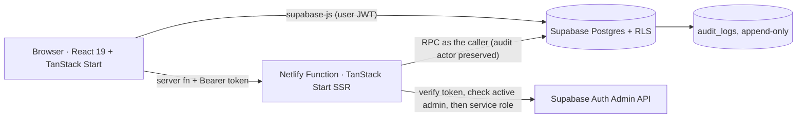
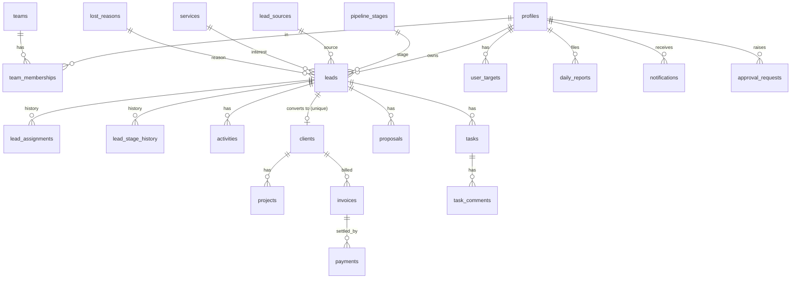

# Architecture

**Authorization boundary = Postgres.** The browser talks to Supabase directly with the *publishable* key and the user's JWT; every read/write passes RLS, column grants and RPC checks. The only server code is user administration (`src/lib/admin.functions.ts`), which verifies the JWT with Supabase Auth, re-reads the caller's profile (active + admin) and only then uses the service-role key (never in the client bundle: `*.server.ts`, no `VITE_` prefix).

**Layers**: `src/lib/supabase.ts` (client, error mapping) → `src/lib/api.ts` (typed queries/mutations, one place for query keys) → routes (presentation). Business rules live in SQL (`supabase/migrations`), once: stage gates, qualification score, conversion, assignment, payment math, metrics (`app.metric_value`).

**Auth flow**: invite (admin) → email link → `/reset-password` sets password → sign-in → `AuthProvider` loads `profiles` row (RLS returns nothing for inactive users ⇒ "Account not active"). Role comes only from `profiles.role`; JWT claims/metadata are never read.

**Deployment**: Netlify builds with `@netlify/vite-plugin-tanstack-start` (client → `dist/client`, SSR/server functions → `.netlify/v1/functions/server.mjs`, verified by a real build). 

## ER diagram

